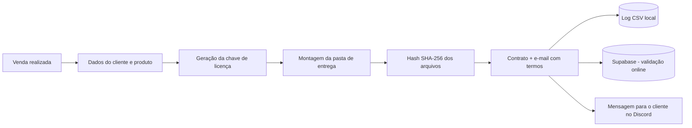

# 🛒 Arkan Store — Sistema de Entregas e Licenciamento Digital


> 🔒 **Repositório de apresentação.** O código-fonte fica em um repositório **privado** porque o Arkan Store é um produto comercial ativo. Aqui estão a descrição, a arquitetura, as tecnologias e as decisões técnicas do projeto.

---

## 📋 Sobre o projeto

O **Arkan Store** é um sistema desktop que criei para automatizar as vendas de uma loja de produtos digitais (mods gráficos e ferramentas de otimização para GTA V / FiveM).

Antes dele, cada venda exigia trabalho manual: gerar a chave de licença, montar a pasta do cliente, escrever o contrato e registrar a venda. O sistema faz tudo isso em poucos cliques, com menos erros e mais segurança.

**Problema real → solução com software.**

---

## ✨ Funcionalidades

| Funcionalidade | Descrição |
|---|---|
| 🔑 Geração de licenças | Chave única vinculada ao cliente (nome + CPF + produto) |
| 📦 Entrega automática | Monta a pasta de entrega com os arquivos do produto comprado |
| 📄 Documentos legais | Gera o contrato de licença de uso e o e-mail com os termos (Lei 9.609/98 e Lei 9.610/98) |
| 🔐 Integridade | Hash SHA-256 dos arquivos entregues |
| 📊 Histórico | Log de todas as vendas em CSV |
| ☁️ Validação online | Sincronização opcional das licenças com o Supabase |
| 💬 Atendimento | Mensagem formatada pronta para enviar ao cliente pelo Discord |
| 🖥️ Interface | GUI moderna com CustomTkinter |

---

## 🧭 Fluxo de uma venda



---

## 🏗️ Estrutura do projeto (repositório privado)

```
arkan-store/
├── ArkanEntrega.py       # Aplicação principal (interface + lógica de entregas)
├── supabase_config.py    # Integração com Supabase (credenciais lidas do .env)
├── .env.example          # Modelo das variáveis de ambiente
├── requirements.txt      # Dependências
└── .gitignore            # Ignora .env, logs e arquivos sensíveis
```

---

## 🚀 Tecnologias

- **Python 3** — linguagem principal
- **CustomTkinter** — interface gráfica
- **Supabase (REST API)** — banco de dados online para validar licenças
- **python-dotenv** — variáveis de ambiente
- **hashlib / uuid** — chaves de licença e verificação de integridade
- **csv / json / zipfile / shutil** — logs, empacotamento e organização das entregas

---

## 🔒 Boas práticas de segurança

- Credenciais e chave secreta ficam **somente** no `.env` local, nunca no código versionado.
- `.env` listado no `.gitignore` e `.env.example` como modelo.
- Hash SHA-256 para comprovar que os arquivos entregues não foram alterados.

---

## 🧠 O que aprendi com este projeto

- Levantar requisitos a partir de um problema real do negócio
- Separar responsabilidades (interface, regras de negócio e integração com banco)
- Consumir uma API REST e trabalhar com banco de dados em nuvem
- Aplicar segurança básica: variáveis de ambiente, hashing e controle de versão
- Documentar um projeto de forma profissional

---

## 🗺️ Próximos passos

- [ ] Reorganizar o código no padrão **MVC** (model, view, controller)
- [ ] Criar testes automatizados com `pytest`
- [ ] Migrar o log CSV para um banco **SQL** relacional
- [ ] Painel web para o cliente consultar a própria licença

---

## 📫 Contato

Quer ver uma demonstração ou saber mais sobre a arquitetura?

[](https://www.linkedin.com/in/guilherme-henrique-bueno-71a032315/)
[](https://github.com/guizinbuenoo)

Desenvolvido por **Guilherme Henrique Bueno**.
